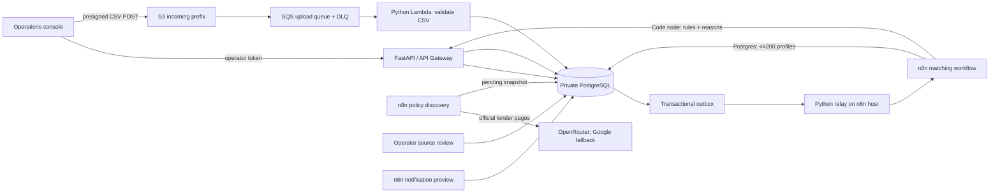

# ClickPe Loan Eligibility Engine

An explainable loan-product screening prototype for the ClickPe engineering-intern assignment. It turns a CSV of applicant profiles and a small catalogue of lender-published criteria into an auditable, source-linked review queue. It is a screening aid: a lender makes the actual lending decision.

## What is included

- **FastAPI and PostgreSQL** for bounded CSV ingestion, applicant records, source snapshots, decisions, event delivery, policy approvals and audit history.
- **React and TypeScript** operations console for importing a file, following a run, inspecting the rule explanation, reviewing policy changes and previewing notifications.
- **Three n8n workflows** for daily official-page discovery, paged applicant matching, and a deduplicated notification preview. Matching is a fixed, versioned rules evaluator in a JavaScript Code node, not an LLM decision.
- **AWS serverless infrastructure** for API Gateway, S3 direct uploads, SQS and a DLQ, Lambda ingestion, private RDS PostgreSQL, retention, and a small n8n host. PostgreSQL and n8n have no public inbound port.
- **Docker Compose** for a local stack with the same n8n workflows and API.
- **GitHub Actions** for backend checks and a production TypeScript build.

## Architecture



### Decisions and safety boundaries

- The n8n matcher queries only `user_id`, income, score, employment status, age and approved rules. Names and email addresses never enter that workflow or an LLM request.
- A hard exclusion requires a confirmed mandatory cutoff. Preferred criteria can only pass or lead to review. Missing or location-specific rules produce `review`; extraction cannot activate policy on its own.
- Product rules cite official source pages. Operators see the extracted criteria and source excerpt before approving a new version. Each result stores the policy snapshot ID, fixed rule-engine version and criterion-level reasons.
- Uploads are size-limited to 25 MiB, the CSV schema and row values are checked, the raw cloud object is deleted after import, and abandoned S3 objects expire after one day. Applicant rows and per-person results are deleted after seven days.
- Workflow deliveries use a transactional outbox, deterministic page cursors and unique keys. A retried SQS delivery or n8n callback does not create duplicate results or pages.
- Execution input and output data are not saved in n8n. Error messages and operational audit records omit applicant values.
- Notifications are **preview-only**. The app writes idempotent preview records and reports unique email counts, but contains no mail-sending node. No controlled test-inbox alias was provided, so it cannot send to the CSV addresses.

## Lender source baseline

The initial examples use official sources checked on 2026-10-14:

- [Axis Bank personal loan for salaried customers](https://www.axis.bank.in/loans/personal-loan/personal-loan-for-salaried): the curated example uses age 21-60, monthly income from INR 15,000, and treats a 700 score as preferred rather than a hard cutoff.
- [Bajaj Finserv personal loan](https://www.bajajfinserv.in/personal-loan): the curated example records a score threshold of 650 and a city-dependent salary criterion. Age and employment criteria remain unknown; successful known checks still go to review.

The linked source is the evidence. The prototype is not a full lender-policy catalogue, and the examples should be refreshed and independently confirmed before any external use.

## Data contract

The input CSV must contain exactly these headers, in any order:

`user_id,name,email,monthly_income,credit_score,employment_status,age`

Rows accept employment values `Salaried`, `Self-Employed`, or `Business`. `user_id` must be unique. Repeated email addresses are retained as separate applicant profiles; previews report both match count and distinct addresses. Bad rows fail the file with a safe error code, without returning row contents.

The assignment file has 10,000 rows, unique IDs, no missing fields, and repeated email addresses. It is intentionally excluded from Git. **Never turn on live mail using this dataset.**

## Local setup

Requirements: Python 3.12+, [`uv`](https://docs.astral.sh/uv/), Node 22+, Docker Desktop with Compose, and a browser.

```powershell
.\scripts\New-Environment.ps1
docker compose --profile local up -d --build
```

The script creates a private `.env` with random local secrets. Keep it out of source control. The compose stack runs Postgres, the API, n8n with an external task runner, an outbox relay and the web console.

Open [http://localhost:3000](http://localhost:3000) for the console. Retrieve the local operator token with:

```powershell
(Get-Content .env | Where-Object { $_.StartsWith('OPERATOR_TOKEN=') }) -replace '^OPERATOR_TOKEN=', ''
```

Open [http://localhost:5678](http://localhost:5678), create the n8n owner account, then configure credentials on the imported workflows:

1. **ClickPe internal token**: Header Auth, name `X-Internal-Token`, value from `INTERNAL_API_TOKEN` in `.env`. Assign it to both workflow Webhook triggers and their internal HTTP Request nodes.
2. **ClickPe Postgres**: host `db`, port `5432`, database/user `loan_engine`, password from `POSTGRES_PASSWORD`. Assign it to all Postgres nodes. TLS is disabled for local Compose only.
3. **OpenRouter**: Header Auth with name `Authorization` and value `Bearer <OpenRouter key>`.
4. **Google Gemini**: Header Auth with name `x-goog-api-key` and the separate Gemini API key.

Activate the three imported workflows. Workflow 1 checks lender sources daily. Workflows 2 and 3 are authenticated webhooks invoked from the transactional outbox. Source proposals remain pending until you approve them in the console.

For local static analysis and tests:

```powershell
uv sync --extra dev
uv run ruff check app tests
uv run pytest
npm --prefix web ci
npm --prefix web run build
```

These checks do not need the supplied CSV or the LLM API keys.

## AWS demo deployment

The deployment script targets the `demo` stage in `ap-south-1`. It provisions a private PostgreSQL instance and Lambda networking, S3, SQS/DLQ, generated Secrets Manager values, API Gateway and an EC2 n8n host. The n8n host accepts no inbound connection; use Systems Manager to forward local ports. An authenticated AWS profile with the required CloudFormation, IAM, VPC, RDS, Lambda, API Gateway, S3, SQS, Secrets Manager and EC2 permissions is required.

```powershell
npm ci
.\scripts\Deploy-Aws.ps1 -AwsProfile dpratik -Stage demo -LambdaArtifactPath .aws-build\loan-engine.zip
```

The script deploys the Linux Lambda package built by the **Build Lambda package** workflow, applies database migrations, and uploads an application bundle with no CSV, screenshots, `.env`, or Git history. The ASGI server and relay HTTP client are installed only in the Docker image. To rebuild the package, run the GitHub Actions workflow and use `gh run download RUN_ID --name clickpe-lambda --dir .aws-build`.

Read the operator token from the ARN printed at deployment time, then start two PowerShell sessions. The first opens the console tunnel:

```powershell
aws ssm start-session --profile dpratik --region ap-south-1 --target INSTANCE_ID --document-name AWS-StartPortForwardingSession --parameters '{"portNumber":["3000"],"localPortNumber":["3000"]}'
```

The second opens n8n:

```powershell
aws ssm start-session --profile dpratik --region ap-south-1 --target INSTANCE_ID --document-name AWS-StartPortForwardingSession --parameters '{"portNumber":["5678"],"localPortNumber":["5678"]}'
```

Create the n8n owner account, then configure the internal Header Auth credential and a PostgreSQL credential pointing to the RDS endpoint using its generated password from Secrets Manager. Enable TLS for that RDS credential. Configure separate OpenRouter and Google API credentials if you want to run policy discovery. Attach credentials to workflow nodes, activate the three workflows, and open the web console at [http://localhost:3000](http://localhost:3000).

The `demo` stack is billable while it exists. Retention limits customer-data exposure; it does not stop AWS resource charges. Before deleting the stack, remove its private `deployment/source.zip` artifact from the upload bucket. Also empty the Serverless Framework deployment bucket if stack deletion reports it is non-empty. Do not delete the stack until you have saved anything needed for your submission.

## Demo recording outline

See [docs/demo-script.md](docs/demo-script.md) for a short screen-recording plan built around the assignment's “whiteboard defense” prompt. Explain the trust boundaries and one failure case before showing the console.

## Main paths

- `app/api/routes.py`: operator API, policy-review gates, workflow handoffs and notification previews.
- `app/csv_ingestion.py`: bounded CSV validation, idempotent import and outbox event.
- `app/eligibility.py`: versioned deterministic evaluator and review fallbacks.
- `migrations/`: product snapshots, applicant data, results, outbox, notification events and audit records.
- `n8n/workflows/`: the three credential-free workflow exports.
- `serverless.yml`: AWS stack, private networking and function-level permissions.
- `web/src/`: responsive operator console.
