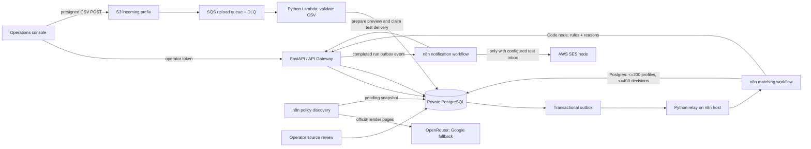

# ClickPe Loan Eligibility Engine

An explainable loan-product screening prototype for the ClickPe engineering-intern assignment. It turns a CSV of applicant profiles and a small catalogue of lender-published criteria into an auditable, source-linked review queue. It is a screening aid: a lender makes the actual lending decision.

## What is included

- **FastAPI and PostgreSQL** for bounded CSV ingestion, applicant records, source snapshots, decisions, event delivery, policy approvals and audit history.
- **React and TypeScript** operations console for importing a file, following a run, inspecting the rule explanation, reviewing policy changes and previewing notifications.
- **Three n8n workflows** for daily official-page discovery, paged applicant matching, and deduplicated notification previews with an optional controlled SES test delivery. Matching is a fixed, versioned rules evaluator in a JavaScript Code node, not an LLM decision.
- **AWS infrastructure** for the API, S3 direct uploads, SQS and a DLQ, Lambda ingestion, private RDS PostgreSQL, retention, a private n8n host, and an HTTPS console served from the API Gateway origin. PostgreSQL and n8n have no public inbound port.
- **Docker Compose** for a local stack with the same n8n workflows and API.
- **GitHub Actions** for backend checks and a production TypeScript build.

## Architecture



### Decisions and safety boundaries

- The n8n matcher queries only `user_id`, income, score, employment status, age and approved rules. Names and email addresses never enter that workflow or an LLM request.
- A hard exclusion requires a confirmed mandatory cutoff. Preferred criteria can only pass or lead to review. Missing or location-specific rules produce `review`; extraction cannot activate policy on its own.
- Product rules cite official source pages. Operators see the extracted criteria and source excerpt before approving a new version. Each result stores the policy snapshot ID, fixed rule-engine version and criterion-level reasons.
- Uploads are size-limited to 25 MiB, the CSV schema and row values are checked, the raw cloud object is deleted after import, and abandoned S3 objects expire after one day. Applicant rows and per-person results are deleted after seven days.
- Workflow deliveries use a transactional outbox, deterministic page cursors and unique keys. A retried SQS delivery or n8n callback does not create duplicate results or pages.
- Execution input and output data are not saved in n8n. Error messages and operational audit records omit applicant values.
- Notifications default to **preview**. Workflow C includes an SES node behind a server-controlled gate: `NOTIFICATION_MODE=test`, one `TEST_RECIPIENTS` address, and `SES_SENDER` must be configured. The destination always comes from this allowlist, never from a CSV row. The current hosted demo has no test inbox configured, so delivery remains disabled.
- Every run pins its approved product snapshots at import. New approvals affect future runs only. Pages hold at most 200 applicants and 400 applicant-product decisions; the persistence endpoint checks the complete expected page before advancing the cursor.
- A test delivery claims at most one eligible applicant per run and lists all of that applicant's matched products. The SES node does not retry sends: an ambiguous send outcome requires checking SES and `test_delivery` before a manual resend, avoiding automatic duplicate messages.

## Lender source baseline

The initial examples use official sources checked on 2026-10-14:

- [Axis Bank personal loan for salaried customers](https://www.axis.bank.in/loans/personal-loan/personal-loan-for-salaried): the curated example uses age 21-60, monthly income from INR 15,000, and treats a 700 score as preferred rather than a hard cutoff.
- [Bajaj Finserv personal loan](https://www.bajajfinserv.in/personal-loan): the curated example records a score threshold of 650 and a city-dependent salary criterion. Age and employment criteria remain unknown; successful known checks still go to review.

The linked source is the evidence. The prototype is not a full lender-policy catalogue, and the examples should be refreshed and independently confirmed before any external use.

## Data contract

The input CSV must contain exactly these headers, in any order:

`user_id,name,email,monthly_income,credit_score,employment_status,age`

Rows accept employment values `Salaried`, `Self-Employed`, or `Business`. `user_id` must be unique. Repeated email addresses are retained as separate applicant profiles; previews report both match count and distinct addresses. Bad rows fail the file with a safe error code, without returning row contents.

The assignment file has 10,000 rows, unique IDs, no missing fields, and repeated email addresses. It is intentionally excluded from Git. **Never turn on live mail using this dataset.**

## Local setup

Requirements: Python 3.12+, [`uv`](https://docs.astral.sh/uv/), Node 22+, Docker Desktop with Compose, and a browser.

```powershell
.\scripts\New-Environment.ps1
docker compose --profile local up -d --build
```

The script creates a private `.env` with random local secrets. Keep it out of source control. The compose stack runs Postgres, the API, n8n with an external task runner, an outbox relay and the web console.

Open [http://localhost:3000](http://localhost:3000) for the console. Retrieve the local operator token with:

```powershell
(Get-Content .env | Where-Object { $_.StartsWith('OPERATOR_TOKEN=') }) -replace '^OPERATOR_TOKEN=', ''
```

Open [http://localhost:5678](http://localhost:5678), create the n8n owner account, then configure credentials on the imported workflows:

1. **ClickPe internal token**: Header Auth, name `X-Internal-Token`, value from `INTERNAL_API_TOKEN` in `.env`. Assign it to both workflow Webhook triggers and their internal HTTP Request nodes.
2. **ClickPe Postgres**: host `db`, port `5432`, database/user `loan_engine`, password from `POSTGRES_PASSWORD`. Assign it to all Postgres nodes. TLS is disabled for local Compose only.
3. **OpenRouter**: Header Auth with name `Authorization` and value `Bearer <OpenRouter key>`.
4. **Google Gemini**: Header Auth with name `x-goog-api-key` and the separate Gemini API key.

Activate the three imported workflows. Workflow 1 checks lender sources daily. Workflows 2 and 3 are authenticated webhooks invoked from the transactional outbox. Source proposals remain pending until you approve them in the console.

For local static analysis and tests:

```powershell
uv sync --extra dev
uv run ruff check app tests
uv run pytest
npm --prefix web ci
npm --prefix web run build
```

These checks do not need the supplied CSV or the LLM API keys.

## AWS demo deployment

The deployment script targets the `demo` stage in `ap-south-1`. It provisions a private PostgreSQL instance and Lambda networking, S3, SQS/DLQ, generated Secrets Manager values, API Gateway and an EC2 n8n host. The n8n host accepts no inbound connection; use Systems Manager to forward its local port. An authenticated AWS profile with the required CloudFormation, IAM, VPC, RDS, Lambda, API Gateway, S3, SQS, Secrets Manager and EC2 permissions is required.

```powershell
npm ci
.\scripts\Publish-Web.ps1 -AwsProfile dpratik -Stage demo
```

The script builds the console for the API's same-origin URL, packages it with the Linux Lambda application, applies database migrations, and uploads an application bundle with no CSV, screenshots, `.env`, or Git history. The ASGI server and relay HTTP client are installed only in the Docker image. To build a Lambda artifact in CI, run the **Build Lambda package** workflow; its archive includes the console assets.

Build and deploy the public operator console:

```powershell
.\scripts\Publish-Web.ps1 -AwsProfile dpratik -Stage demo
```

The command builds the React console into the Lambda package and serves the page and its static assets from the API Gateway HTTPS origin. The console URL is the API base URL printed by the command; opening it loads the workspace sign-in screen. The console and API share one origin, and S3 upload CORS is restricted to that API origin. The browser still requires the operator token; retrieve it from Secrets Manager using the ARN printed by the deployment script. Keep the token private.

Open n8n through a Systems Manager port-forwarding session:

```powershell
aws ssm start-session --profile dpratik --region ap-south-1 --target INSTANCE_ID --document-name AWS-StartPortForwardingSession --parameters '{"portNumber":["5678"],"localPortNumber":["5678"]}'
```

The deployment updates the existing EC2 services through Systems Manager, imports stable workflow IDs, binds the internal API and RDS credentials, and publishes matching and notification workflows. It downloads the AWS RDS CA bundle and verifies database certificates for n8n. Existing external credential bindings are retained. Discovery is published when both provider credentials are configured; otherwise it stays unpublished with the curated baseline available for matching.

Configure `OPENROUTER_API_KEY` and `GEMINI_API_KEY` privately in `/opt/clickpe/.env` (or bind the two provider Header Auth credentials in n8n), then rerun the host update. The owner account is still needed for accessing the n8n editor. The import updates the draft and publishing takes effect after n8n restarts.

Before each host update, the previous source is retained in `/opt/clickpe/previous-source.tar.gz` and the previous workflow export in the n8n volume. On failure, stop the relay, inspect the SSM command, restore compatible source and workflow versions, and restart services. Database migrations are additive; do not drop the new tables during rollback.

The `demo` stack is billable while it exists. Retention limits applicant-data exposure; it does not stop AWS resource charges. Before deleting the stack, remove its private `deployment/source.zip` artifact from the upload bucket. Also empty the Serverless Framework deployment bucket if stack deletion reports it is non-empty. Do not delete the stack until you have saved anything needed for your submission.

## Demo recording outline

See [docs/demo-script.md](docs/demo-script.md) for a short screen-recording plan built around the assignment's “whiteboard defense” prompt. Explain the trust boundaries and one failure case before showing the console.

## Main paths

- `app/api/routes.py`: operator API, policy-review gates, workflow handoffs and notification previews.
- `app/csv_ingestion.py`: bounded CSV validation, idempotent import and outbox event.
- `app/eligibility.py`: versioned deterministic evaluator and review fallbacks.
- `migrations/`: product snapshots, applicant data, results, outbox, notification events and audit records.
- `n8n/workflows/`: the three credential-free workflow exports.
- `serverless.yml`: AWS stack, private networking and function-level permissions.
- `web/src/`: responsive operator console.

## Controlled SES demonstration

A received email is required by the assignment. This remains a submission blocker until an inbox you control is available. An alias is optional; a normal inbox is sufficient.

1. Verify the sender and, while SES is in the sandbox, the controlled recipient in `ap-south-1`. Complete verification from your inbox yourself.
2. Configure an AWS credential on Workflow C's SES node with only the required SES sending permissions, scoped to the verified sender and destination. Enable that node if the deployed preview configuration disabled it.
3. Set `NOTIFICATION_MODE=test`, `TEST_RECIPIENTS=<one controlled inbox>`, and `SES_SENDER=<verified sender>` in the host's private `.env`. Restart the API so it loads the settings. Keep credentials and addresses out of Git and the recording.
4. Complete a new run. Workflow C prepares previews, selects one eligible applicant, substitutes the controlled destination, sends through SES, and records the SES MessageId. With no eligible applicant, it records the preview without sending.
5. Show the received email and its matched product list in the recording. Restore `NOTIFICATION_MODE=preview` after the demonstration. Do not manually rerun an ambiguous delivery without inspecting its claim and SES receipt.

## Validation and submission

CI runs the actual n8n matcher JavaScript against disposable PostgreSQL fixtures. Coverage includes import SQL, three-product pagination, policy changes during a run, duplicate callbacks, incomplete-page rejection, notification handoff, policy audit inserts, and terminal relay failures. Set `TEST_DATABASE_URL` to a disposable PostgreSQL database to run the integration cases locally; the fixture creates and drops an isolated schema.

The live submission should show one complete 10,000-row run. Record the run ID, pinned product count, expected and actual decisions, elapsed time (`completed_at - started_at`), peak batch size, and per-pair LLM request count (zero). Use observed numbers from that run; do not present synthetic integration fixtures as production throughput measurements.

Before submission, record the 5-10 minute walkthrough in `docs/demo-script.md`, complete the received SES test email, and invite `ujjwalkala-clickpe`, `HarshSrivastav-Dailype`, `ManishBiswal-clickpe`, and `tushar-clickpe` to the private repository. The user chose to invite reviewers later; no invitations have been sent.

Infrastructure tooling still uses Serverless Framework 3 for deployment compatibility. Its transitive dependencies have unresolved audit findings; they are absent from the Python Lambda and browser runtime packages. Compatible audit fixes were insufficient. Pinned overrides patch `tar`, `adm-zip`, and `simple-git`; the local npm audit still reports 18 affected packages, including one critical finding in the legacy archive dependency (checked 2026-10-15). A major toolchain migration requires separate package/deploy validation; do not use `npm audit fix --force` immediately before the submission.
